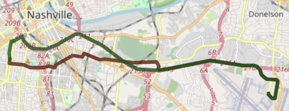

# Generating Historical Traffic Data for Valhalla

This repository contains scripts and Docker files to build and run a time-accurate routing engine using the Valhalla routing engine enhanced with predicted traffic data.

This repo is intedend to enable Valhalla to recognize travel time differences and route accordingly given predicted traffic information and a date time input.
```
time: 2024-09-21T07:00, travel time:  557.625  , travel length:  14.862
time: 2024-09-22T08:00, travel time:  5110.337 , travel length:  14.05
```
<p align="center">
    
</p>

## Getting Started

1. **Clone the Repository:**
   ```shell
   git clone git@github.com:smarttransit-ai/valhalla.git smarttransit-valhalla
   cd smarttransit-valhalla
   ```

2. **Set Up a Virtual Environment:**
   ```shell
   python3 -m venv venv
   venv/bin/python -m pip install -r requirements.txt
   ```

3. **Build the Docker Image:**
   ```shell
   sudo docker build -t valhalla .
   ```

4. **Run the Docker Container:**
   ```shell
   sudo docker run -dt --name valhalla -p 8002:8002 valhalla
   ```

5. **Generate and Add Predicted Traffic:**
   - Open and run the `create_historical_traffic.ipynb` notebook to generate traffic data and add it to the routing graph.

## Note
- Ensure that the Docker container is running before executing the notebook or any scripts involved.

## Loading real INRIX speeds

The notebook puts the same invented week of speeds on every edge. The scripts in `inrix/` load a real week of INRIX speeds instead. INRIX reports a speed per XD segment and Valhalla keeps a week of speeds per edge, so the steps are: find the Valhalla edges under each segment, build a week of speeds for each edge, and load it.

INRIX data is licensed. Keep it, and every file made from it, out of this repository. The steps below write everything into a folder beside the clone, `../inrix_work`.

```shell
mkdir ../inrix_work
```

1. **Get the roads the tiles were built from.** The segments have to be matched on the same OpenStreetMap file as the tiles, or the matched roads may not exist in Valhalla. Copy the file out of the container and cut it to your area and to roads with [osmium](https://osmcode.org/osmium-tool/) (`sudo apt install osmium-tool`). The box is `WEST,SOUTH,EAST,NORTH`. This one is Davidson County.
   ```shell
   docker cp valhalla:/custom_files/tennessee-latest.osm.pbf ../inrix_work/
   osmium extract --bbox -87.051,35.975,-86.517,36.396 ../inrix_work/tennessee-latest.osm.pbf -o ../inrix_work/davidson.osm.pbf
   osmium tags-filter ../inrix_work/davidson.osm.pbf w/highway -o ../inrix_work/davidson_roads.osm
   ```

2. **Match the XD segments to the roads** with [geo-mapper-api](https://github.com/scope-lab-vu/geospatial_mapper), which needs Python 3.11 or later. This step needs its `osm_xml` option, which matches on a saved file instead of a download. The option is in [scope-lab-vu/geospatial_mapper#10](https://github.com/scope-lab-vu/geospatial_mapper/pull/10) and not yet in a release. The first two arguments are INRIX's map files, which the package's README describes.
   ```python
   from geo_mapper_api import inrix_to_osm

   matches = inrix_to_osm.serial("USA_Tennessee.geojson", "USA_Tennessee.csv", ["DAVIDSON"], osm_xml="../inrix_work/davidson_roads.osm")
   matches.to_csv("../inrix_work/matches.csv", index=False)
   ```

3. **Find the Valhalla edges under each segment.** The container has to be running. For a county this takes about ten minutes. Valhalla also returns the edges just before and just past each road piece, so an edge counts only when the piece covers at least half of it. `--min-covered` changes that share.
   ```shell
   venv/bin/python inrix/segment_edges.py --matches ../inrix_work/matches.csv --out ../inrix_work/segment_edges.csv
   ```
   Edge ids belong to one build of the tiles. After the image is built again, repeat steps 1 to 4.

4. **Build the week of speeds.** The container's `way_edges_ids_paths.csv` gives each edge's name in Valhalla and its tile's file, so copy it out first. `--readings` is a Parquet or CSV file, or a folder of Parquet files, with INRIX's columns `xd_id`, `measurement_tstamp`, `speed` and `reference_speed`. The speeds are in mph, and `measurement_tstamp` has to be the local time of the roads, with no time zone. Every reading counts, whatever its `confidence_score`. `--sunday` is the first day of the week to load, and `--out` has to be an empty or new folder.
   ```shell
   docker cp valhalla:/custom_files/valhalla_tiles/way_edges_ids_paths.csv ../inrix_work/
   venv/bin/python inrix/week_speeds.py --readings ../inrix_work/readings/ --segment-edges ../inrix_work/segment_edges.csv --edge-paths ../inrix_work/way_edges_ids_paths.csv --sunday 2026-07-12 --out ../inrix_work/traffic
   ```
   The summary names any day of the week that has no reading at all. Such a day takes each segment's median speed.

5. **Load it.** The script takes the traffic folder and the container's name. It restarts the container at the end, and the server answers again a few seconds later.
   ```shell
   bash valhalla_add_predicted_traffic.sh ../inrix_work/traffic valhalla
   ```
   Valhalla prints `Updated N directed edges`. N should be the number of edges that step 4 reported.

Valhalla keeps one week. A request with a `date_time` gets the speeds of that weekday and time of day, whatever the date. A request without a `date_time` gets each loaded edge's mean speed of the week.

Two limits of Valhalla's format shape the loaded speeds. It packs a week into 200 numbers, which smooths sharp changes. And it does not use a five-minute speed of 5 km/h or less, so `week_speeds.py` raises the slowest speeds of an edge until its packed week stays above that.

The tests use made-up numbers and need no container:
```shell
venv/bin/python -m pytest tests
```

## Files
Below is a description of each file included in this repository.
<details>
<summary>Show/Hide Details</summary>  

### 1. Valhalla DockerFile
- **Description:** This DockerFile is used to build a Docker image for the Valhalla routing engine. The image is built from the official Valhalla docker image 3.5.0 and adds dependencies and tools to run the routing engine with predicted traffic.
- **Usage:**
  ```shell
  sudo docker build -t valhalla .
  sudo docker run -dt --name valhalla -p 8002:8002 valhalla
  ```
- **Modifiers:** Within the DockerFile `tennessee-latest.osm.pbf` is downloaded and referenced, modify those references to fit your needs. [Geofabrik](https://download.geofabrik.de/) has alternatives.

### 2. create_historical_traffic.ipynb
- **Description:** This Jupyter Notebook generates and copies the traffic data to the Docker container, and adds the predicted traffic to the routing graph.
- **Modifiers:** Modify `SPEED DATA` cell to fit your needs
- **Note:** This notebook should be run after the Docker container is built and running.


### 3. valhalla_add_predicted_traffic.sh
- **Description:** This script copies the traffic data to the Docker container and adds the predicted traffic to the routing graph. Every load starts from the tiles without traffic, which the image keeps in `valhalla_tiles_no_traffic.tar`, so the speeds of an earlier load do not stay in the graph.
- **Usage:** The traffic folder defaults to `data/traffic` and the container to `valhalla`.
  ```shell
  bash valhalla_add_predicted_traffic.sh [traffic folder] [container]
  ```

- *This script is called from `create_historical_traffic.ipynb`.*

### 4. valhalla_encode_speed.cc
- **Description:** This C++ program uses the `valhalla::baldr` functions to compress and encode a vector of historical speeds.
- **Input:** Historical speeds of the format:
  ```
  "10, 10, ... 100, 100, 100"
  ```
- **Output:** Encoded speeds of the format:
  ```
  "AAAAAA...AAAAAA"
  ```
- **Usage:**
  ```shell
  ./valhalla_encode_speed <historical_speeds>
  ```
- **Compile:**
  ```shell
  g++ -o valhalla_encode_speed valhalla_encode_speed.cc -I/usr/local/include -L/usr/local/lib -lvalhalla
  ```
- **Dependencies:** Valhalla

- *This program is compiled in DockerFile and called in `create_historical_traffic.ipynb`.*

### 5. valhalla_ways_to_ids.cc
- **Description:** This C++ program uses Valhalla functions to generate the ways_edges export and converts it into a CSV file with the features `osm_id`, `edge_id`, `graph_id`, and `path`.
- **Input:** N/A
- **Output:**
  ```
  valhalla_tiles/way_edges_ids_paths.csv
  ```
- **Usage:**
  ```shell
  ./valhalla_ways_to_ids
  ```
- **Compile:**
  ```shell
  g++ -o valhalla_ways_to_ids valhalla_ways_to_ids.cc -I/usr/local/include -I/usr/local/include/valhalla/third_party -L/usr/local/lib -lvalhalla -lz -lcurl
  ```
- **Dependencies:** Valhalla, libboost-all-dev, protobuf-compiler, libcurl4-openssl-dev

- *This program is compiled and called in DockerFile, and optionally called in `create_historical_traffic.ipynb`.*

### 6. exclusions.ipynb
- **Description:** Demonstration of how to use exclude in the Valhalla API.

### 7. inrix/segment_edges.py
- **Description:** This script finds the Valhalla edges under each INRIX XD segment. It sends the line of every road piece that geo-mapper-api matched to the Valhalla server (`trace_attributes`) and keeps the edges that the line covers at least half of, or the share given with `--min-covered`.
- **Input:** The table geo-mapper-api returns, saved as CSV, with the columns `u`, `v`, `key`, `XDSegID` and `osm_geom`.
- **Output:** A CSV file with the columns `XDSegID` and `valhalla_edge`.
- **Usage:**
  ```shell
  venv/bin/python inrix/segment_edges.py --matches matches.csv --out segment_edges.csv --valhalla http://localhost:8002
  ```

### 8. inrix/week_speeds.py
- **Description:** This script turns one week of INRIX readings into the traffic files that `valhalla_add_predicted_traffic` reads. An edge gets the mean of the segments on it, in km/h. A segment's missing five-minute readings take its median speed of the week.
- **Input:** INRIX readings (`xd_id`, `measurement_tstamp`, `speed`, `reference_speed`), the output of `inrix/segment_edges.py` and the container's `way_edges_ids_paths.csv`.
- **Output:** One CSV file per Valhalla tile, in the folder given with `--out`, which has to be empty or new.
- **Usage:**
  ```shell
  venv/bin/python inrix/week_speeds.py --readings readings/ --segment-edges segment_edges.csv --edge-paths way_edges_ids_paths.csv --sunday 2026-07-12 --out traffic
  ```

### 9. inrix/speed_profile.py
- **Description:** Packs a week of speeds the way `valhalla_encode_speed` does, in Python, so that no call into the container is needed for each edge. It also raises an edge's slowest speeds until Valhalla can use the whole packed week.

</details>  

## Contact
For further questions, please contact [smarttransit-ai](https://github.com/smarttransit-ai).